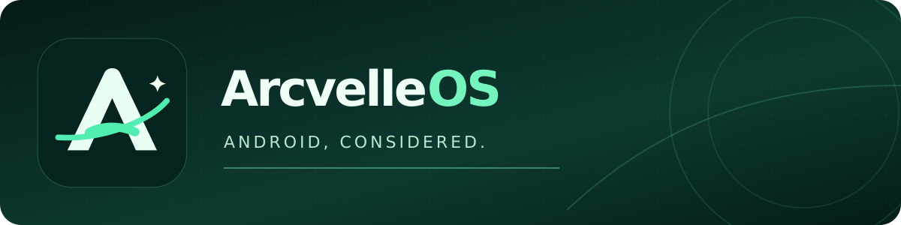

  

# ArcvelleOS

ArcvelleOS is a fork of [Paranoid Android (AOSPA)](https://github.com/AOSPA), built on the Android Open Source Project. It brings together the AOSPA foundation and changes from the Android community, with a focus on a clean experience and useful customization.

## Source and building

The [manifest repository](https://github.com/ArcvelleOS/manifest#readme) contains instructions for downloading and building the source.

- [Vendor configuration](https://github.com/ArcvelleOS/android_vendor_aospa)
- [Android framework](https://github.com/ArcvelleOS/android_frameworks_base)
- [Settings](https://github.com/ArcvelleOS/android_packages_apps_Settings)
- [Xiaomi marble device tree](https://github.com/ArcvelleOS/android_device_xiaomi_marble)

## Contributing

Explore the [repositories](https://github.com/ArcvelleOS?tab=repositories), review the source, or open a pull request to share a change. Please keep the original authorship and credits when bringing in work from other projects.

## Credits

Thanks to [AOSPA](https://github.com/AOSPA), [AOSP](https://source.android.com/), and all the developers and contributors who make this project possible. Individual changes retain their credits in the commit history.
